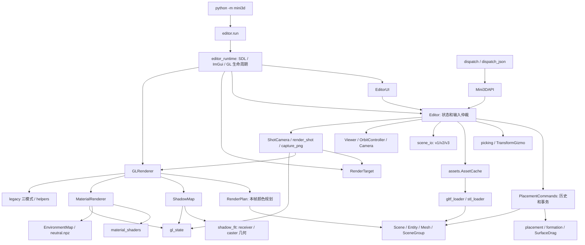

# Mini3D V2 架构与数据流

SPQR Phase 1 在摄影基线 `18a4269` 上增加 `roman_assets` 固定内置模板与 `street` 有限布局。UI/API → PlacementCommands → street → 现有 spawn/分组/事务；AssetCache 缓存共享 Mesh，scene_io 继续使用 v3，无新增渲染或场景系统。[本阶段说明](SPQR-PHASE1.md)。以下 V2 基线说明为历史架构记录，当前摄影视图语义见 [AI View API](ai-view-api.md)。

稳定候选：`refactor/v2-consolidation`，以 Q2 `efd5ddc` 起步，保留 Rome `476a799` 历史。3+1 指 **Placement、Rendering、Photography、AI API**，共用一个 Scene、控制器、命令历史和 renderer。
推荐从项目根运行 `python -B -m mini3d`；`editor_app.py`、`editor.py` 仍转发同一程序。数字入口仅为兼容示例。

## 控制依赖

箭头包括调用和对象读取，不全是 Python import。全部38个生产 Python 模块的直接/函数内延迟 import、入口和行数见 [依赖清单](v2-consolidation/dependencies.json)。逐模块调用者与测试见 [审计](V2-CONSOLIDATION-AUDIT.md)。
独立 API 默认创建无窗口 Editor 状态；正式 runtime 将 `app.api = Mini3DAPI(renderer, editor=app)` 绑定当前 Editor。也可显式绑定已有控制器。
实际 PNG 需要调用者在当前线程提供 GL context 和 renderer；dispatcher 不创建网络服务。

## Placement

Manifest 中已安装资产、文件选择器或 API 路径 → AssetCache 格式分派 → GLB/glTF/STL/builtin ground → CPU模板 → Entity实例 → Commands → Scene.update → picking/placement/Gizmo。
实例共享 Mesh/材质，变换、稳定ID、可见性和锁定独立。GLB保持层级、静态默认皮肤和材质；Y-up基底转换到Z-up，STL保留原轴与尺寸。
连续 Gizmo/SurfaceDrag 用事务token，一次手势对应一次Undo，Esc取消；API/UI通过同一Commands修改。
SceneGroup是成员关系，不reparent导入层级；PlacementPlane仅查询，Ground是显式实体，grid是辅助线。
现代Scene使用XYZ Euler、向量scale及现有导入基底组合；legacy示例保留标量scale、pitch/yaw/roll和 `extra_local @ T @ R @ S`。
geometry示例Scene只输出model节点，URDF另保留axes-only link；原规则和数字入口的公共符号均保留。

## Rendering

1. Scene.update 更新世界矩阵；RenderPlan读取本帧矩阵和bounds，准备view/projection、保守六面AABB剔除、legacy/imported与opaque/BLEND分区及统计。
2. Color可见性不限制shadow_candidates。ShadowMap保留画外caster，shadow_fit按receiver/caster不同几何条件拟合；无有效fit时回退全场景。
3. ShadowMap写自有depth FBO；MASK测alpha，Unlit可投但不受，BLEND不投透射阴影。它借用MR上传缓存，不拥有该缓存。
4. GLRenderer绘制legacy REALISTIC/TOON/OUTLINE，再让MaterialRenderer消费Plan；独立entity-list调用仍可使用。GLSL在material_shaders，GPU上传/材质/uniform由MR所有。
5. BLEND仍按mesh中心深度排序，normal仍用原pseudoinverse；EnvironmentMap管理固定离线split-sum cube/LUT，Scene只保存开关/强度。
6. Editor绘制grid/axes/selection，Gizmo是UI overlay。clean Shot隐藏辅助元素，不改原Scene。

Scene几何/状态、RenderPlan本帧颜色规划、shadow_fit拟合、RenderTarget附件生命周期职责独立。
Viewer framing、全场景clipping、placement bounds和shadow prism intersection的目的/容错不同，不能见到AABB就合并。
本轮复用Plan分类/投影，保留不同目的bounds和两份不同阈值/math-numpy结果约定的Euler提取。

## Photography、存档与所有权

ShotCamera独立保存pose/FOV/near/far、36mm horizontal gate焦距、画幅和samples=1/4；Editor导航不改变Shot。
Preview letterbox和composition grid属于UI。render_shot浅拷贝clean Scene，关闭grid/world/entity axes，使用Scene lighting和同一render pass。
RenderTarget负责1x或4x附件、完整color/depth/stencil resolve、resize/close；Camera View与PNG复用结果。
capture_png隔离PACK/PBO并恢复调用者独立READ/DRAW framebuffer、viewport、renderer尺寸及pack状态；默认1x不变。
scene_io保持v1/v2/v3载入、v3保存、临时文件原子替换；Editor原save/load/_load方法和子类hook保留。
载入先用临时Scene/Viewer/Shot校验，成功后替换实时状态并清空历史；失败可能填充CPU缓存，不承诺零分配。存档引用模型，不内嵌GLB。

| 内容 | 所有者 / 回收 |
| --- | --- |
| CPU模板、共享Mesh | AssetCache / Scene引用；导入Mesh按不可变资源约定 |
| 状态、selection、业务历史 | Editor / Scene / Commands；UI与API同一个控制器 |
| SDL、ImGui、previews | editor_runtime的ExitStack，构造失败也回收已创建资源 |
| legacy VAO/VBO/EBO、guides | GLRenderer.close，销毁context之前 |
| 材质网格/贴图/program/selection | MaterialRenderer.release/close；旧Shader常量和状态方法仍re-export |
| IBL cube/LUT | EnvironmentMap，由MR持有并close |
| shadow depth/FBO/program | ShadowMap.close；只借用MR上传结果 |
| viewport/MSAA附件 | RenderTarget.resize/close；调用者持有 |
| GL状态工具 | gl_state仅借用当前context，不拥有GPU资源 |

API dispatch保持白名单、签名校验、逐命令错误和事务限制。CPU renderer、URDF和旧数学helper仍保留，未因低使用频率删除。
运行程序只读本版本自身资源；历史Git快照、便携Blender只供验证。原Q2 .blend/HDR/图片/license保留，私有清单不推送。
见 [功能清单](V2-FEATURES.md)、[Bug与限制](V2-BUGS.md)、[验证结果](V2-VALIDATION.md)。
