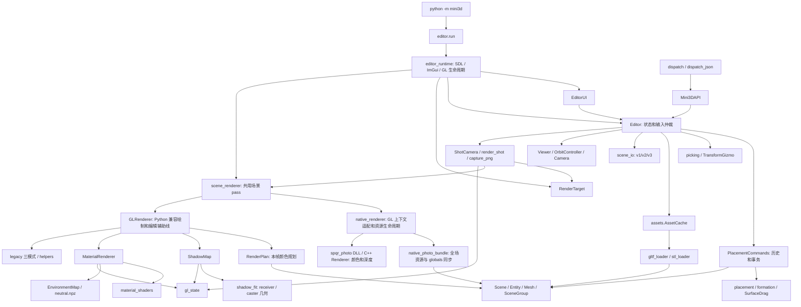

# Mini3D 架构与数据流

Arrange、Lighting 的浏览视口和 Shot 预览/PNG 共用 `scene_renderer.render_scene`。
场景、命令历史、拾取与 UI 仍由 Python 编辑器拥有；支持的场景颜色和真实深度由
`NativeSceneRenderer` 调用 C++ 核心绘制。网格、坐标轴、选择轮廓和 Gizmo 仍属于编辑器。
缺少 DLL 时 auto 使用 Python；不支持的模型或 Wireframe 会记录回退原因；显式 native
或 require-native 模式拒绝回退。Lit 与 Unlit 均可使用原生材质路径。

共享调用链：`editor_runtime / shot_camera → scene_renderer → native_renderer → spqr_photo DLL → Renderer`。
Python 兼容路径为 `scene_renderer → GLRenderer → MaterialRenderer / ShadowMap`。
`native_photo.py` 保留旧导入入口，`native_photo_bundle.py` 为两个工作区同步同一 Scene
的网格、材质、纹理与参数；DLL 名称及 ABI 版本 v1 保持不变，live renderer 另要求
新增的共享纹理和批量变换导出。

以下 Placement、Python 绘制细节和 V2 资料保留其对应边界；性能和 GPU 结论按各自的资产、脚本和采样范围理解，不作为通用性能保证。当前 native GPU 验收入口见 [NATIVE-PHOTO.md](../NATIVE-PHOTO.md)。

SPQR Phase 1 在摄影基线 `18a4269` 上增加 `roman_assets` 固定内置模板与 `street` 有限布局。UI/API → PlacementCommands → street → 现有 spawn/分组/事务；AssetCache 缓存共享 Mesh，scene_io 继续使用 v3，无新增渲染或场景系统。[本阶段说明](SPQR-PHASE1.md)。以下 V2 基线说明为历史架构记录，当前摄影视图语义见 [AI View API](ai-view-api.md)。

稳定候选：`refactor/v2-consolidation`，以 Q2 `efd5ddc` 起步，保留 Rome `476a799` 历史。3+1 指 **Placement、Rendering、Photography、AI API**，共用一个 Scene、控制器、命令历史和 renderer。
推荐从项目根运行 `python -B -m mini3d`；`editor_app.py`、`editor.py` 仍转发同一程序。数字入口仅为兼容示例。

## 控制依赖

箭头包括调用和对象读取，不全是 Python import。全部38个生产 Python 模块的直接/函数内延迟 import、入口和行数见 [依赖清单](v2-consolidation/dependencies.json)。逐模块调用者与测试见 [审计](V2-CONSOLIDATION-AUDIT.md)。
独立 API 默认创建无窗口 Editor 状态；正式 runtime 将 `app.api = Mini3DAPI(renderer, editor=app)` 绑定当前 Editor。也可显式绑定已有控制器。
实际 PNG 需要调用者在当前线程提供 GL context 和 renderer；dispatcher 不创建网络服务。

## Placement

Manifest 中已安装资产、文件选择器或 API 路径 → AssetCache 格式分派 → GLB/glTF/STL/builtin ground → CPU模板 → Entity实例 → Commands → Scene.update → picking/placement/Gizmo。
实例共享 Mesh/材质，变换、稳定ID、可见性和锁定独立。GLB保持层级、静态默认皮肤和材质；Y-up基底转换到Z-up，STL保留原轴与尺寸。
连续 Gizmo/SurfaceDrag 用事务token，一次手势对应一次Undo，Esc取消；API/UI通过同一Commands修改。
SceneGroup是成员关系，不reparent导入层级；PlacementPlane仅查询，Ground是显式实体，grid是辅助线。
现代Scene使用XYZ Euler、向量scale及现有导入基底组合；legacy示例保留标量scale、pitch/yaw/roll和 `extra_local @ T @ R @ S`。
geometry示例Scene只输出model节点，URDF另保留axes-only link；原规则和数字入口的公共符号均保留。

## Rendering

1. `scene_renderer` 统一尺寸、AA、实际后端与回退统计。原生后端在内部完成 1x/4x
   resolve，将颜色、深度和 stencil 复制到调用者的单采样 `RenderTarget`；不能再
   resolve 未使用的 Python MSAA FBO。Python 路径由同一入口完成 target resolve。
2. Arrange 原样使用 Scene 的 Studio/Scene 灯光、atmosphere、地面和显示模式。
   Shot 在摄影层浅拷贝 clean Scene，关闭编辑辅助元素并使用 Scene 灯光及照片色彩；
   它不改动源 Scene。原生帧可优化 near，只写入 `target.render_camera`，不改原相机。
3. 原生完成后，Arrange 用实际 `render_camera` 画网格/坐标轴；runtime 再将选择轮廓
   叠加到当前 target。网格和选择不改真实深度。Gizmo 保留 UI 投影和原输入语义。
4. 一个 GLRenderer 持有一个 native renderer，两个工作区共用已提交 handle 和资源缓存；交互准备期间可临时持有另一个未就绪 handle。
   旋转 Studio 相机只更新相机相关灯光 globals；平移、尺寸、AA 不重建资源。
   Scene 相机运动不更新世界灯光。阴影只在 Scene + Lit + shadows enabled 时开启。
5. 已上传场景中的纯实体变换通过 `spqr_photo_transforms` 按 bundle 索引批量更新
   所有变化 leaf；C++ 先校验整个批次，再提交并失效阴影缓存。实体拓扑/可见性、mesh
   identity/bounds、材质或环境资源变化仍导出并重建完整 bundle。CPU Scene 与 Commands 始终是权威状态；
   这不等于 C++ 原生编辑器，冷加载仍有资源准备成本。

交互初始化分两条边界：`asset_loader` 的唯一 daemon worker 使用私有 AssetCache 解析模型和解码图片，`editor_loading` 主线程 poll/adopt 后调用已有 Add/Drop/Import 命令；同步 API 保留。取消、历史操作、加载场景和退出屏蔽迟到结果，不 join 正在解析的 worker。RGBA 解码缓存绑定原 image identity，图像替换不能误用旧像素。

`NativeSceneRenderer.prepare_step` 和 C API begin_shared/prepare_step 在创建线程及原 context 中逐任务执行 Python 资源准备、单张纹理上传、bundle、C++ 逐程序编译和逐网格上传。完成后才替换已提交 handle；资源失效/退出销毁部分初始化且保留借用纹理。bundle 导出时保存矩阵版本，准备期间的变换由首帧 transforms 补齐。已有视口在后续准备时保留到新场景就绪，廉价任务按约 6 ms 预算合并推进。相同 context/处理后 shader 源码的 native ProgramSet 用弱缓存共享；最后一个 renderer 释放 program，每个 renderer 绘制前重应用自己的 globals。单个驱动调用仍可能阻塞，详见 [启动与线程边界](editor-startup.md)。

Python 兼容绘制内部：

1. Scene.update 更新世界矩阵；RenderPlan值检查本帧矩阵和bounds，复用未变化的世界包围盒，准备view/projection、保守六面AABB剔除、legacy/imported与opaque/BLEND分区及统计。
2. Color可见性不限制shadow_candidates。ShadowMap保留画外caster，shadow_fit按receiver/caster不同几何条件拟合；无有效fit时回退全场景。
3. ShadowMap写自有depth FBO；MASK测alpha，Unlit可投但不受，BLEND不投透射阴影。它借用MR上传缓存，不拥有该缓存。
4. GLRenderer绘制legacy REALISTIC/TOON/OUTLINE，再让MaterialRenderer消费Plan；独立entity-list调用仍可使用。GLSL在material_shaders，GPU上传/材质/uniform由MR所有。兼容不透明重复网格在阴影与颜色中实例化，MASK/BLEND及legacy保留原路径；不改变Scene实体与选择结构。[性能边界](SPQR-PERFORMANCE.md)。
5. BLEND仍按mesh中心深度排序，normal仍用原pseudoinverse；EnvironmentMap管理固定离线split-sum cube/LUT，Scene只保存开关/强度。
6. Editor绘制grid/axes/selection，Gizmo是UI overlay。clean Shot隐藏辅助元素，不改原Scene。

Scene几何/状态、RenderPlan本帧颜色规划、shadow_fit拟合、RenderTarget附件生命周期职责独立。
Viewer framing、全场景clipping、placement bounds和shadow prism intersection的目的/容错不同，不能见到AABB就合并。
本轮复用Plan分类/投影，保留不同目的bounds和两份不同阈值/math-numpy结果约定的Euler提取。

## Photography、存档与所有权

ShotCamera独立保存pose/FOV/near/far、36mm horizontal gate焦距、画幅和samples=1/4；Editor导航不改变Shot。
Preview letterbox和composition grid属于UI。render_shot浅拷贝clean Scene，关闭grid/world/entity axes，使用Scene lighting和共用场景render pass；景深在有效绘制相机上处理。
RenderTarget负责1x或4x附件、完整color/depth/stencil resolve、resize/close；Camera View与PNG复用结果。
capture_png隔离PACK/PBO并恢复调用者独立READ/DRAW framebuffer、viewport、renderer尺寸及pack状态；默认1x不变。
scene_io保持v1/v2/v3载入、v3保存、临时文件原子替换；Editor原save/load/_load方法和子类hook保留。
载入先用临时Scene/Viewer/Shot校验，成功后替换实时状态并清空历史；失败可能填充CPU缓存，不承诺零分配。存档引用模型，不内嵌GLB。

| 内容 | 所有者 / 回收 |
| --- | --- |
| CPU模板、共享Mesh | AssetCache / Scene引用；导入Mesh按不可变资源约定 |
| 后台解析/解码与请求结果 | AssetLoader 私有 worker/cache；EditorAssetLoading 在主线程交付，取消/关闭不接受迟到结果 |
| 状态、selection、业务历史 | Editor / Scene / Commands；UI与API同一个控制器 |
| SDL、ImGui、previews | editor_runtime的ExitStack，构造失败也回收已创建资源 |
| native handle、bundle 临时目录及 C++ GL 资源 | GLRenderer 持有 NativeSceneRenderer；借用创建它的同一 GL context/线程，在 context 销毁前 close，目录保留到 handle 销毁 |
| legacy VAO/VBO/EBO、guides | GLRenderer.close，销毁context之前 |
| 材质网格/贴图/program/selection/实例VAO与VBO | MaterialRenderer.release/close；旧Shader常量和状态方法仍re-export |
| IBL cube/LUT | EnvironmentMap，由MR持有并close |
| shadow depth/FBO/program | ShadowMap.close；只借用MR上传结果 |
| viewport/MSAA附件 | RenderTarget.resize/close；调用者持有 |
| GL状态工具 | gl_state仅借用当前context，不拥有GPU资源 |

live bundle v2 只传现有 GL texture target/handle；`spqr_photo_create_shared` / `spqr_photo_begin_shared` 在调用方
当前 WGL context 中借用它们，不读回/上传像素、不修改存储或采样参数，也不在 native
close 时删除。纹理仍由 MaterialRenderer / Environment 等 Python 资源所有者管理，必须
先销毁 native handle，再释放这些纹理和 GL context。`spqr_photo_create` 与离线 v1 像素
bundle 保持原行为，不能加载 v2。C ABI 版本仍是 v1，但 live renderer 要求新增的
`spqr_photo_create_shared` 与 `spqr_photo_transforms` 导出；旧 DLL 必须重建后才能用于
共享 live bundle。拓扑、材质等资源变更重建 bundle，实体变换仅更新原生实体状态。

API dispatch保持白名单、签名校验、逐命令错误和事务限制。CPU renderer、URDF和旧数学helper仍保留，未因低使用频率删除。
运行程序只读本版本自身资源；历史Git快照、便携Blender只供验证。原Q2 .blend/HDR/图片/license保留，私有清单不推送。
见 [功能清单](V2-FEATURES.md)、[Bug与限制](V2-BUGS.md)、[验证结果](V2-VALIDATION.md)。
