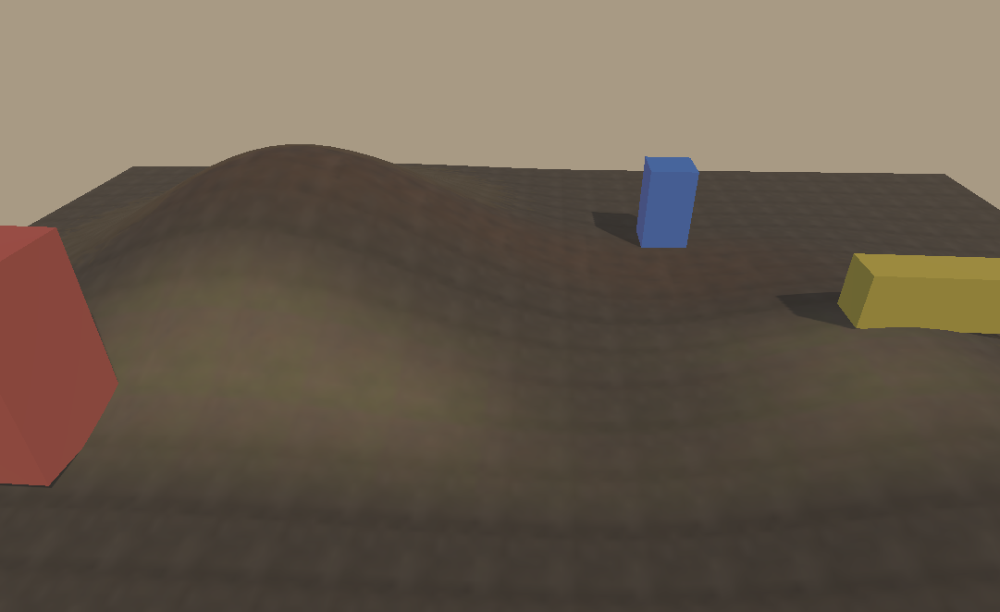
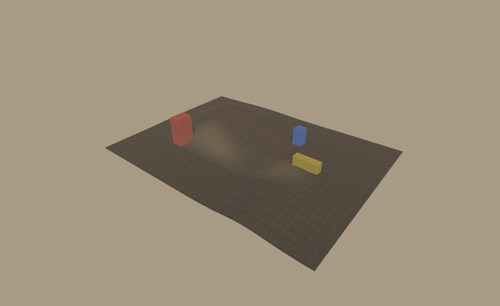
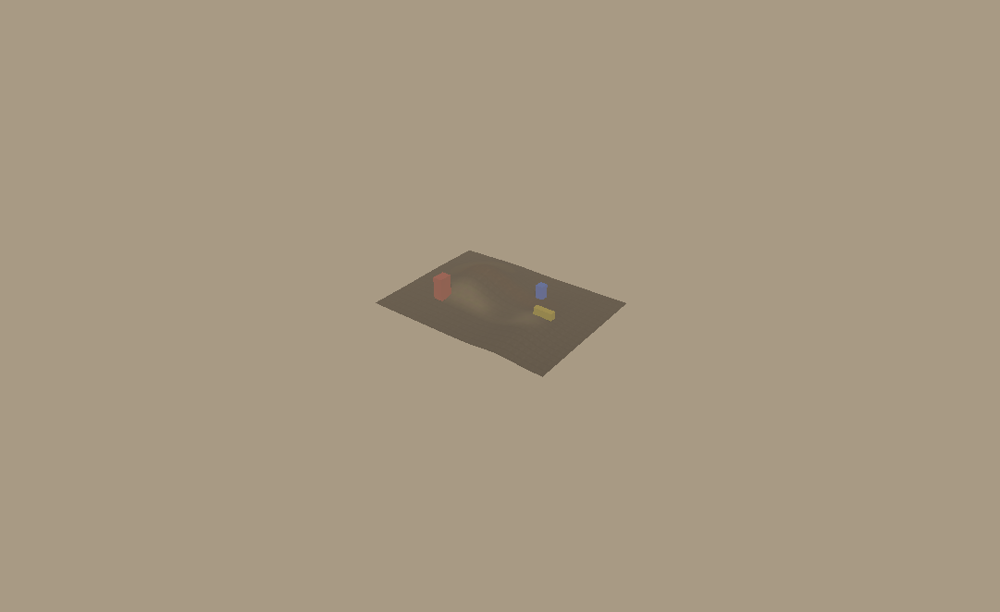

# LAB-02B · 三层材质绘制与更新方案

2026-10-19，原实现报告基于 HEAD `4c8b380` 及当时工作区，随后提交至 `spqr-terra@7a4e884`。结论：**独立三层材质实验功能通过，视觉待验收；选择“静态预滤材质atlas＋动态权重图”继续实验。** 土壤、岩石、草地均为真实Base Color/Normal/Roughness贴图；支持绘制、擦除、提交、取消、区域差异Undo/Redo和预算回滚。尚未接入主编辑器。材质真实感改进另见 [LAB-02B-Q1](QUALITY.md)，本报告保留原始功能与性能证据。

## 复现与输入

在仓库根目录、现有桌面GL环境运行，输出目录须为空：

```powershell
F:/gymenv/python.exe -B experiments/world-surroundings/run_paint.py --output captures/world-surroundings/paint-check
F:/gymenv/python.exe -B experiments/world-surroundings/run_paint.py --output captures/world-surroundings/paint-live --interactive --scheme layered
```

`1/2/3`选择土壤/岩石/草地，`E`切换绘制/擦除；左键按住拖动、松开提交，滚轮设置下一笔半径，`Esc`取消，`Z/Y`撤销重做，关闭窗口结束。切换层/擦除模式会取消活动笔画。强度按实验预设，标题显示模式、半径和历史预算拒绝原因；没有正式工具面板、画笔范围圈或相机导航。

环境和构建要求沿用 [README](README.md)：Python3.8.20、NumPy1.24.3、Pygame2.6.1、Pillow9.5.0，MinGW g++15.2/C++20、CMake、Ninja。构建在`captures/world-surroundings/build-lab02b`，不替换用户正式DLL。

素材为Poly Haven的Brown Mud 02、Rock Face、Leafy Grass，CC0-1.0。原图1K，实验保留256×256 RGB8，每层9个预滤级派生自同一套图；世界周期分别为1.3/2.4/2米。作者、许可、原始URL/字节摘要、准备方式及限制见 [NOTICE](assets/materials/NOTICE.md) 和 [manifest](assets/materials/manifest.json)。9张输入共958785字节。运行离线，不引入外部引擎或第三方算法代码。

## 数据、画笔与纹理更新

- 高度网格65×65、36×26米；权重257×257×3，不依赖高度图分辨率。行向+Y、列向+X、包含世界两端点，默认土壤权重1。
- `PaintSession`保存不可变float32权重和修订号。圆形smoothstep衰减，按秒以`1-exp(-strength*dt*falloff)`累计；绘制向目标层1收敛，其余层同比缩减。擦除向目标层0收敛，释放量按其他层原比例分配；其余均为0则均分。
- 同一笔冻结参数，鼠标路径按不超过半径20%重采样、均分帧时间。固定位置时间拆分已测；任意不同移动采样不保证逐位一致。每笔记录受影响矩形前后差异，默认64MiB历史预算；拒绝时回滚并继续会话，保留既有Redo。
- 上传权重为RGBA8，RGB量化，shader采样后重新归一化；CPU权威数据仍为float32。Base Color先sRGB解码再线性混合，Normal按OpenGL切线空间解码、混合后归一，Roughness线性混合、金属度0。权重不当作AO使用。
- 静态预滤链的颜色在线性空间平均、法线平均后归一、粗糙度线性平均；三层各占256宽列，9级256至1像素图垂直隔离打包到768×511 atlas。shader按世界UV导数选择相邻两级手工三线性混合，级内只采样自身纹素中心，避免层/级串色。GL存储仍是单级RGBA8。CPU烘焙按烘焙纹素的世界足迹选择同一预滤链。
- 分层方案仅以`TexSubImage2D`上传权重脏区；烘焙方案重算并批量上传三张材质图脏区。两者持续使用同一Renderer、纹理句柄和program，不重导Bundle。初始导出使用临时包装捕获函数，明确只保留本实验材质的level0；仅设置MAX_LEVEL不能删除已分配的旧mip。
- 实验bridge扩展局限于已有friend钩子；只更新独占单级RGBA8 2D线性纹理，整批先校验，成功后同步Bundle CPU像素。正式ABI、Bundle格式、生产shader未改。实验Bundle的shader副本沿用原光照/阴影/色彩主体，并以限定fixture中唯一的`hasAO`识别Terrain，不能当作通用材质类型。

具体边界见 [PAINT-DESIGN.md](PAINT-DESIGN.md)。

## 真实图像与性能选择

最终证据：[完整报告](review/lab02b-20261019-verified/report.json)、[连续绘制GIF](review/lab02b-20261019-verified/layered/paint-replay.gif)、[输入事件](review/lab02b-20261019-verified/layered/input-replay.json)、[最终权重](review/lab02b-20261019-verified/layered/weights.npy)。此处链接为review中的审阅快照；完整原始产物仍位于已忽略的captures。

| 257×257 CPU烘焙，近景 | 分层＋预滤，近景 |
| --- | --- |
|  |  |

| 分层斜俯 | 分层远景 |
| --- | --- |
|  |  |

已检查真实图像。最初无预滤的atlas出现高频噪点，修正后重新跑完整验证；旧结果见[无预滤对照](review/lab02b-20261019-run02/report.json)。烘焙图覆盖整块36×26米，密度仅约7.1×9.8纹素/米；分层图按每层物理周期重复，近景保留更多细节。提高烘焙分辨率的成本未实测，不能将本次差异归纳为所有分辨率下的性能结论。

实际GPU为 **Intel UHD Graphics 620，OpenGL3.3.0，驱动27.20.100.8682**。1081×662、1x AA、稳定远阴影1024/近阴影4096；同一斜俯机位、65×65地形和三个静止标记。LAB-00/01的MX130 viewer成绩不与此横比。实验DLL SHA256：`c504709ad75b8a052a2af16ab1058e1d054771cf704e421e96dc7796fcb5cd1f`。

两方案串行执行相同114帧Pygame事件，步长1/30秒：三层绘制、草地擦除、预览取消、Undo/Redo；输入JSON和最终权重摘要相同。计时包含事件、当前地形拾取、CPU编辑/混合、上传、绘制及glFinish、swap；检查点读回/导出和录像另行执行。最终测量期间不并行跑CPU测试或其他GPU任务。

| 毫秒 | CPU烘焙 P50/P95/P99 | 分层 P50/P95/P99 |
| --- | ---: | ---: |
| 完整实验帧 | 44.80 / 58.00 / 65.72 | 14.93 / 17.49 / 19.10 |
| CPU处理与上传 | 34.41 / 47.27 / 54.21 | 4.30 / 7.19 / 8.86 |
| 原生绘制与glFinish | 10.44 / 11.68 / 12.25 | 10.40 / 11.20 / 12.17 |

分层最大完整帧19.45ms、最大CPU处理/上传9.25ms；烘焙分别85.66/73.82ms。此样例分层满足33.33ms目标，CPU烘焙不满足。因此选择分层路线继续实验，仍需正式集成时复测编辑器完整帧。

| 载荷/传输 | CPU烘焙 | 分层 |
| --- | ---: | ---: |
| 测量期间批次数 | 110 | 110 |
| 测量期间上传字节 | 5397204 | 1799068 |
| 材质/权重GL level0载荷 | 792592 | 4973572 |
| float32权威权重 | 792588 | 792588 |
| 四笔区域差异历史 | 996744 | 996744 |

上传统计已扣除计时前的GL状态/预算测试，录像上传另计。载荷表不含天空/IBL/阴影或驱动开销，未测进程峰值/实际显存。shader编译计数始终3，几何上传计数始终0。最终权重SHA256：`6ab203f81d824ee98ff1d354e18c42875ade7967829dbc3c14ca9675aa62f07c`。

GIF来自同一持久Renderer恢复初始权重后的第二轮实际回放，每5帧读一次颜色，共23帧、648×397，固定模拟时间播放；不代表墙钟帧率，不混入性能数据。最终权重与测量相同。当前使用内置确定性回放生成器，事件JSON用于审查，未提供任意JSON重放CLI。

## 验证与未覆盖项

- 两方案各8个检查点，GPU纹理与CPU载荷逐字节相同，地形VBO未变。每方案初始、三层绘制、擦除、Undo共6个全量新建参考，RGBA/远阴影深度逐字节相同；取消/Redo与擦除完成状态相同。三个最终机位也与参考逐字节相同；参考先按相同相机顺序预热，避免稳定阴影缓存的初始历史差异。
- 错误后续纹理ID、重复目标、越界矩形整批拒绝，读回和计数不变；实际GL上传失败标fatal，不承诺驱动错误下回滚。非默认pack/unpack alignment、row length/skip、PBO绑定、active unit和2D绑定在成功更新及读回后保持一致。错误线程/context拒绝；context恢复后正常运行。
- 历史预算为0的真实事件路径：预览上传后松键拒绝提交、会话继续、CPU/GPU恢复初始状态。无变化、擦除回退、时间拆分、非法输入、差异历史和保留Redo有CPU回归。
- 98项CPU回归通过：World Surroundings 55、Placement 10、Native Renderer 12、Native Preparation 6、Scene Snapshot 15。项目环境命令见下；没有宣称全仓库所有测试通过。
- [前阶段雕刻GPU回归](review/lab02b-sculpt-regression/report.json)通过，覆盖新增纹理接口后原有顶点更新/拾取/阴影/撤销路径。[可见窗口30帧启动记录](review/lab02b-20261019-window/report.json)通过，明确不是人工鼠标体验验收，输入逻辑由真实Pygame队列回放验证。

```powershell
F:/gymenv/python.exe -B -m unittest discover -s tests -p 'test_world_surroundings_*.py'
```

当前是有限规模原型，预滤使用各向同性世界XY映射；陡坡拉伸、各向异性过滤、正式Texture Array/材质类型、完整Editor UI、统一模型/地形/权重历史、Scene持久化、Shot同步和Python fallback仍待处理。当前权重的`.npy`仅为证据，不是Scene格式。Q-1后续原型与限制见[QUALITY.md](QUALITY.md)。当前优先级改为[SUR-00外围实验](SURROUNDINGS.md)，Q续作与LAB-02C完整Spline/挖填后置，保留各自验收关卡。
