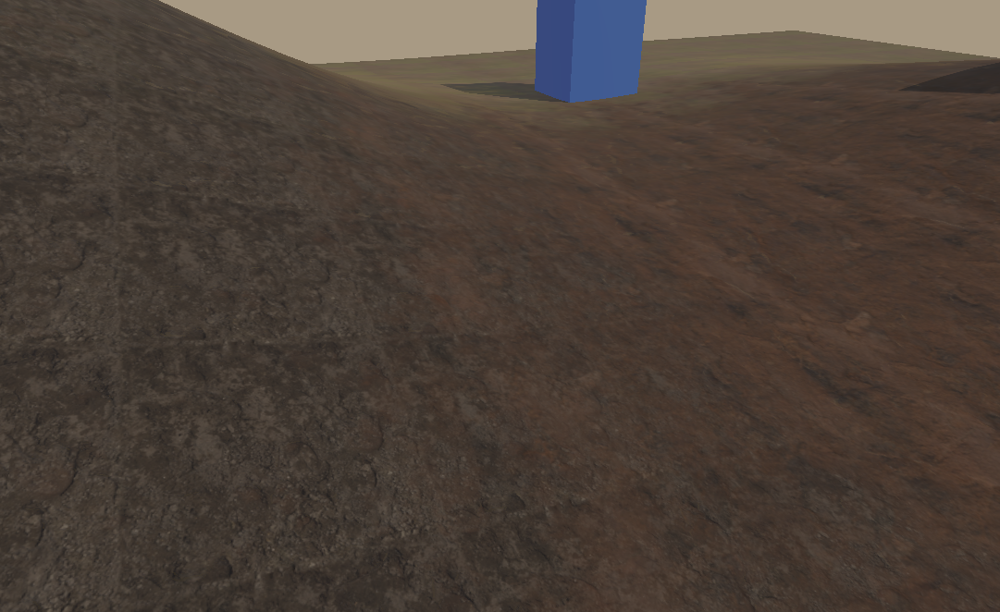
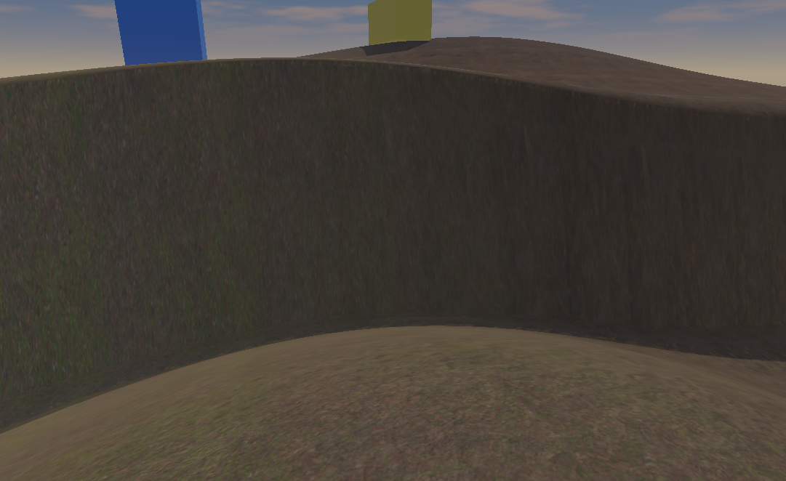
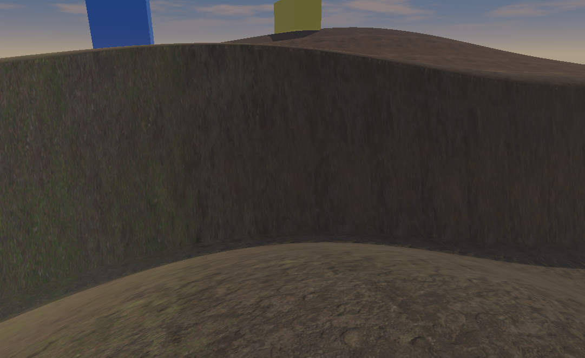

# LAB-02B-Q1 · 材质高度混合

状态：**Q-1 已有可运行原型，自动功能检查通过；导航性能未达标，摄影画质待审阅。整体 LAB-02B-Q 未通过。** 当前仅 Q-1；去重复、Triplanar 与几何细节尚未实现。作为外围分支的相关实验基础保留，道路和正式 Editor 集成保持暂停，未合并生产功能。

2026-10-20优先级调整：**Q续作HOLD，先进行 [World Surroundings外围实验](SURROUNDINGS.md)**。本报告保留原算法、图像和测量，不将原型改记为通过；外围采用独立低成本路径和范围验收，不以前置完成全部Q或Spline为条件。

直接审阅：[原始图像、动态回放和汇总](review/lab02b-q1-20261019/README.md)、[完整指标与独立核验](review/lab02b-q1-20261019/summary.json)。源码调查、素材准备/测试与 GPU 计时由 Luna Max 分工完成，主 Agent 负责渲染适配、回放、实机测量和目视检查。

## 复现

使用现有 Windows 桌面 GL 环境、`F:/gymenv/python.exe`、MinGW C++20、CMake 与 Ninja；依赖沿用 [实验 README](README.md)。以下目录必须为空，构建使用隔离的 `captures/world-surroundings/build-lab02b-q`，不替换生产 DLL。

```powershell
F:/gymenv/python.exe -B experiments/world-surroundings/run_quality.py --output captures/world-surroundings/q1-review-forward --samples 120 --warmup 24 --repeats 2
F:/gymenv/python.exe -B experiments/world-surroundings/run_quality.py --output captures/world-surroundings/q1-review-reverse --variants B_power B_depth A_control A --samples 120 --warmup 24 --repeats 1
F:/gymenv/python.exe -B experiments/world-surroundings/capture_quality_slope.py --input captures/world-surroundings/q1-review-forward --output captures/world-surroundings/q1-review-slope
```

第二次逆序执行用于判断顺序/温度波动；GPU 任务串行，不同时运行 CPU 测试。`--visible` 显示该独立回放窗口。`--strength`、`--width`、`--sharpness` 调整候选参数，默认分别 `.75/.35/4`；参数写入报告和实际 Shader，不改人工权重。GPU 参数约束为 strength `[0,1]`、width `[1e-4,2]`、sharpness `[0,64]`。

未跳过零层采样的前置对照保存在 `captures/world-surroundings/q1-20261019-verified`，当时的两个实验脚本保留于该目录的 `source-snapshot/`；它用于解释为什么需要采样优化，不能混充最终版本的测量。

本报告的 A/B_power 来自 `q1-20261019-active`（正序2轮）和 `q1-20261019-reversed`（逆序1轮）。最后的边界审查发现旧 depth 会让极小权重的高层突然抢占交界，已补上 HTerrain 的近零 smoothstep 抑制和两项回归。修复后的 A_control/B_depth 单独在 `q1-guard-forward`（2轮）与 `q1-guard-reverse`（1轮）重测，表格不混入旧depth数据。生成的 B_power Shader 与此前逐字节相同，A 未改；独立核验同时确认全部回放事件和最终权重一致。旧源码快照随 [测量证据](review/lab02b-q1-20261019/measurements/forward/source-snapshot/quality_materials.py) 保留。以上复现命令会用当前修正版重新运行四方案。

第三条命令补拍无遮挡坡面：原侧视机位与红色基准标记物重叠，不能据此验收坡面纹理。补拍使用相同场景、材质、权重、DLL和光照，所有方案统一位置 `(-7,4,5.8)`、目标 `(0,2,3.3)`；单独记录相机与源摘要，不覆盖原PNG或改写已有性能样本。这组图只提供视觉证据。

运行时离线读取已有 PBR 与新高度图。仅需重新准备素材时运行：

```powershell
F:/gymenv/python.exe -B experiments/world-surroundings/prepare_quality_assets.py
F:/gymenv/python.exe -B -m unittest discover -s tests -p 'test_world_surroundings_*.py'
```

## 输入与实验分离

| 方案 | 行为 |
| --- | --- |
| A | 原 LAB-02B Shader、PBR 输入与世界 XY 预滤采样 |
| A_control | 集中采样 PBR/高度并跳过严格零权重层，strength=0；检验采样优化是否改变输出或成本 |
| B_depth | 对称三层正残差高度混合，近零 smoothstep 抑制、严格零层保护与原权重强度混合 |
| B_power | 三层幂次高度重加权，log-domain 实现并保留同样的人工权重边界 |

算法公式、锁定上游、移植变化与 MIT 原文见 [QUALITY-SOURCES](QUALITY-SOURCES.md)。三套材质高度来自同一 Poly Haven 素材，作者、源图/输出哈希、范围和误差见 [高度素材 NOTICE](assets/material-heights/NOTICE.md) 及 [manifest](assets/material-heights/manifest.json)。土壤源 PNG 只有 8 位，输出转码为 uint16 不会增加精度；另两项源为 16 位。GPU 中三者最终都量化为 **8-bit alpha**，不能宣传为 16-bit GPU 高度混合。RGB 仍走原线性颜色流程，高度单独线性预滤；不改变普通模型透明度。

`baseline` 使用 LAB-02B 原 65×65、36×26米高度场；`steep` 仅增加一个4.5米高的窄 tanh 坡阶，用于暴露拉伸，各方案共享相同高程。每种地形有相同近景、斜俯、远景及坡面侧视；新近景比原报告更靠近，原提交 PNG 仍保留。导航使用120帧固定连续轨迹。

真实 Pygame 绘制回放仍从全土壤开始，检查四笔提交、擦除、预览取消、Undo/Redo。该组 `views/` 是回放最终权重。另提供 `diagnostic-*.png`，采用所有方案相同的平滑权重坡带，隔离观察高度混合交界；这是受控诊断输入，不冒充自然分布或侵蚀结果。两组权重均保存 `.npy`。

## 测量与验收口径

每个方案/地形分别记录静止、导航及114帧相同绘制事件回放。静止/导航预热24帧，再取120帧，首轮各重复两次；绘制检查点的导出、GPU读回与全量重建不进入单帧计时。相机与绘制 GIF 分别录制，不计入帧时。GIF 缩至648×397且使用固定模拟时长，不表示墙钟帧率。

完整帧包括事件、拾取/CPU权重操作、上传、原生提交/既有 `glFinish` 与交换。GPU timestamp 按 AO 槽标记的连续地形颜色绘制区段汇总，排除天空和三个标记物；包含区段内状态、几何/PBR/阴影查询等工作，**不是纯材质算术时间**。查询只读取已完成结果；每组要求样本完整且无丢弃，另专门测试32对query ring溢出能明确报告、启停恢复、错误线程拒绝和计时前后像素一致。

内存表使用实际分配的RGBA8纹理载荷估算，不是驱动总显存/峰值；另计权重、历史、PBR/高度CPU预滤数组。所有方案共享天空、IBL与阴影资源，这些不算到材质新增成本。源高度与GPU alpha的量化误差另行分析。

功能关卡包括每个方案8个检查点的纹理逐字节读回、地形VBO不变、与全量新建Renderer的RGBA/远阴影深度逐字节对照；材质公式另以512组实际GLSL浮点输出对照NumPy参考。该功能关卡与摄影画质关卡分开。

## 实测结果（2026-10-19）

实际 GPU：Intel UHD Graphics 620，OpenGL 3.3.0 / Build 27.20.100.8682。1081×662、1x AA，沿用原光照、远阴影1024/近阴影4096。测量日期为2026-10-19，证据于2026-10-20整理完成。每方案静止/导航正序各2轮、逆序各1轮，以下合并原始样本后求百分位：静止/导航每行360帧，编辑每行228帧。没有剔除慢帧；单轮P95和最大值也保留在原始JSON中。四方案来自上文注明的两组测量批次，不能据跨批次小幅差值给算法排名。`report.json` 的 `passed` 只表示测量脚本及自动检查成功，**不表示达到33.33ms预算或视觉验收通过**。

| 原LAB-02B地形，毫秒 | 静止 P50/P95/P99 | 导航 P50/P95/P99 | 编辑 P50/P95/P99 |
| --- | ---: | ---: | ---: |
| A | 17.18 / 21.23 / 24.66 | 33.92 / 43.57 / 51.23 | 16.13 / 23.95 / 43.20 |
| A_control | 16.06 / 17.46 / 21.69 | 28.89 / 35.09 / 35.72 | 15.39 / 22.29 / 27.17 |
| B_depth | 16.17 / 17.92 / 29.01 | 29.27 / 35.59 / 36.94 | 16.15 / 21.95 / 29.68 |
| B_power | 15.95 / 19.48 / 21.25 | 30.61 / 37.57 / 41.44 | 15.19 / 21.99 / 27.31 |

| 陡坡诊断地形，毫秒 | 静止 P50/P95/P99 | 导航 P50/P95/P99 | 编辑 P50/P95/P99 |
| --- | ---: | ---: | ---: |
| A | 16.55 / 20.99 / 31.37 | 30.70 / 38.79 / 45.99 | 15.31 / 20.88 / 30.33 |
| A_control | 15.92 / 19.37 / 21.19 | 27.13 / 32.11 / 35.73 | 14.93 / 19.63 / 27.95 |
| B_depth | 16.05 / 21.33 / 21.82 | 29.75 / 37.24 / 40.93 | 17.05 / 23.84 / 28.05 |
| B_power | 14.59 / 17.12 / 18.53 | 27.72 / 36.93 / 44.78 | 15.58 / 20.50 / 28.30 |

新增导航轨迹会在近处让大面积地形铺满画面，并触发移动阴影更新。原 A 自身也不满足目标，因此原固定斜俯编辑回放的历史17.49ms不能用于宣称此导航场景达标。原地形 B_depth/B_power 的导航预算余量分别为 **−2.26/−4.24ms**，陡坡为 **−3.91/−3.60ms**；连硬预算都未稳定满足，不能声称还有足够城市场景余量。独立实验也不代表正式编辑器帧率。

| 地形/方案 | 地形颜色 GPU P95：编辑 / 导航，ms |
| --- | ---: |
| 原地形 A | 10.30 / 33.03 |
| 原地形 A_control | 9.50 / 27.66 |
| 原地形 B_depth | 9.49 / 28.62 |
| 原地形 B_power | 9.77 / 28.56 |
| 陡坡 A | 8.94 / 29.47 |
| 陡坡 A_control | 8.38 / 25.16 |
| 陡坡 B_depth | 11.66 / 29.91 |
| 陡坡 B_power | 9.16 / 28.12 |

这是完整地形颜色区段，不是从材质中分离出的纯ALU时间。顺序反转后仍有波动，修复前后批次也有差异；不能据小幅差值宣称某算法必然更快。A_control 同时合并重复采样、调整单级atlas读取并跳过严格零层，A→A_control 的变化不能孤立归因于某一项。零层跳采样减少了纯层区域的读取量，但三层均有权重的区域仍需全部采样，不能据全土壤区域推算复杂城市成本。

## 内存、上传与精度

| 材质/权重资源（不含天空、IBL、阴影等） | A | A_control / B |
| --- | ---: | ---: |
| GL RGBA8单级载荷 | 4,973,572 B | 4,973,572 B |
| 原PBR CPU预滤数组（含各原图，去除共享引用重复） | 2,359,287 B | 2,359,287 B |
| 新增高度 CPU float64预滤数组 | 0 | 2,097,144 B |
| float32人工权重 | 792,588 B | 792,588 B |
| 原地形四笔历史 | 996,744 B | 996,744 B |
| 陡坡四笔历史 | 1,491,744 B | 1,491,744 B |

初始 native `TexImage2D` 使用GL_FLOAT源数据，因此相同四张纹理的初始源载荷推算为19,894,288字节，GPU内部RGBA8存储为上表数值；这不是实际驱动传输总量或显存峰值。编辑均为110次脏区上传：原地形每方案1,799,068字节，陡坡1,886,984字节。高度数据静态打包，不随笔画重传。不同地形的拾取/落点与区域历史不同，只在同一地形内比较各方案。录制、诊断坡带上传不混入编辑统计。

GPU高度最终为8位alpha，各层各级预滤后的最大归一误差约 **0.001961（0.5/255）**，平均约0.000971～0.000983；源图缩至256²的误差在素材manifest单列。非线性权重函数可放大高度误差，不能把输入量化误差当作最终颜色误差上界。尚未比较独立16位高度纹理的画质/成本，暂不为此增加采样。

## 原始图像与观察

| 同地形、同机位、同受控权重 A | B_depth |
| --- | --- |
|  |  |

| 同一陡坡 A，无遮挡补拍 | B_depth，无遮挡补拍 |
| --- | --- |
|  |  |

已目视检查近景、斜俯、远景和无遮挡坡面。正残差/幂次候选在近景使岩石细节与土壤的交界更依赖贴图内部高低，减少单纯透明叠色的感觉；这是局部改善，没有变出真正体积。较弱的草地笔触会被重加权压低，强度过高会过度锐化原笔刷边界。三层绘制权重本身始终保留，关闭效果可恢复。

远景变化较小，纹理重复没有被本阶段解决；侧壁仍有非常明显的竖向拉伸，高度混合不能替代投影修正。草地仍是平面材质，没有叶片轮廓，岩石没有真实碎石体积；没有声明已得到摄影级地表。没有对PNG增强曝光、生成新细节或用示意图代替结果。

[真实绘制近景](review/lab02b-q1-20261019/baseline/B_depth/views/close.png)、[B_power近景](review/lab02b-q1-20261019/baseline/B_power/views/close.png)、[斜俯](review/lab02b-q1-20261019/baseline/B_depth/views/oblique.png)、[远景](review/lab02b-q1-20261019/baseline/B_depth/views/distant.png)、[连续镜头](review/lab02b-q1-20261019/baseline/B_depth/camera-motion.gif)、[绘制/擦除/取消/Undo/Redo](review/lab02b-q1-20261019/baseline/B_depth/paint-replay.gif) 均保留原始来源。审阅目录内PNG逐字节复制，摘要在独立manifest中。

## 功能与兼容性验证

- 124项CPU回归通过：World Surroundings 81项（含新增数学17、素材6、材质打包3），native renderer/preparation、snapshot、placement共43项；见 [修复后81项记录](review/lab02b-q1-20261019/measurements/q1-cpu-tests-world-guard.txt) 与 [此前未受影响43项的记录](review/lab02b-q1-20261019/measurements/q1-cpu-tests.txt)。后者同时保留修复前79项结果，不能重复计数；没有宣称全仓库所有测试通过。
- 两地形、四方案、正逆序每组8个检查点：纹理与CPU载荷逐字节相同，地形VBO不变，动态与全量新建Renderer的RGBA/远阴影深度逐字节一致；取消/Undo/Redo及预算回滚通过，各方案同地形最终权重和输入事件一致。
- 实际GLSL对独立NumPy参考每方案512组，depth最大绝对误差约2.01e-7，power约1.59e-7，均小于3e-6容差。GPU计时每组无丢样；另测禁用为空、ring满明确丢弃、重新启用、错误线程拒绝和计时前后像素一致。
- 原 A 斜俯/远景与已提交LAB-02B原PNG逐像素相同，原地形最终权重仍为 `6ab203f81d824ee98ff1d354e18c42875ade7967829dbc3c14ca9675aa62f07c`。采样优化 A_control 相对 A 仅个别颜色通道出现1/255舍入差，远阴影逐字节相同；不是宣称所有颜色逐字节一致。
- [LAB-02A真实GPU雕刻回归](review/lab02b-q1-20261019/measurements/sculpt/report.json)通过，覆盖顶点更新、拾取、法线/阴影和历史。实验默认计时关闭。无实验宏的生产 viewer、photo/shadow DLL全部构建通过，生产ABI、Scene/UI/API未改。
- 补拍采用与对应测量完全相同的DLL/场景/权重，源摘要与相机参数见 [A/B_power记录](review/lab02b-q1-20261019/measurements/unoccluded-slope-report.json) 和 [修复后control/depth记录](review/lab02b-q1-20261019/measurements/guard-slope-report.json)；未覆盖原样图和性能数据。输入事件另比较12组回放/地形，文件逐字节相同。人工鼠标体验、正式Editor导航/Shot、跨硬件性能及进程/驱动显存峰值未验收。

## 当前结论与下一步

1. **高度混合是否更自然？** 近景受控交界有局部改善，但对强度和人工权重敏感；不足以关闭摄影画质关卡，最终仍需用户审阅。
2. **重复是否改善？** 本阶段没有启用去重复，仍明显，不能算通过。
3. **陡坡是否需要Triplanar？** 无遮挡图已证明世界XY拉伸严重，需要评估局部岩壁投影；是否选完整Triplanar仍须质量/预算实验。
4. **UHD 620最值得保留哪种组合？** 暂保留零层跳采样与两个高度候选，均不设正式默认；小幅速度差不足以定胜负，尚无包含去重复/Triplanar的最优组合结论。A_control的收益不归功于高度公式。
5. **是否进入正式集成评审？** **否。** 导航硬预算和整体画质未通过，Q-2/Q-3未完成。

Q恢复后先针对大面积近景/导航的采样与颜色绘制成本做独立预算检查，并复审微表面混合强度，再评估低成本Q-2单项；不盲目叠加效果或改变阴影/曝光包装达标。当前先做SUR-00外围对照，独立验证地表连续、摄影范围和低成本远景，详见 [当前规划](../../PROJECT.md)。完整道路、正式散布工具与Terra集成后置；固定外围示例不代表这些编辑能力已交付。
