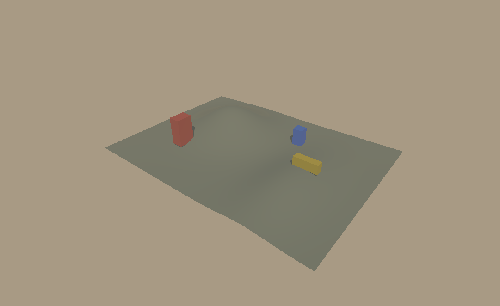
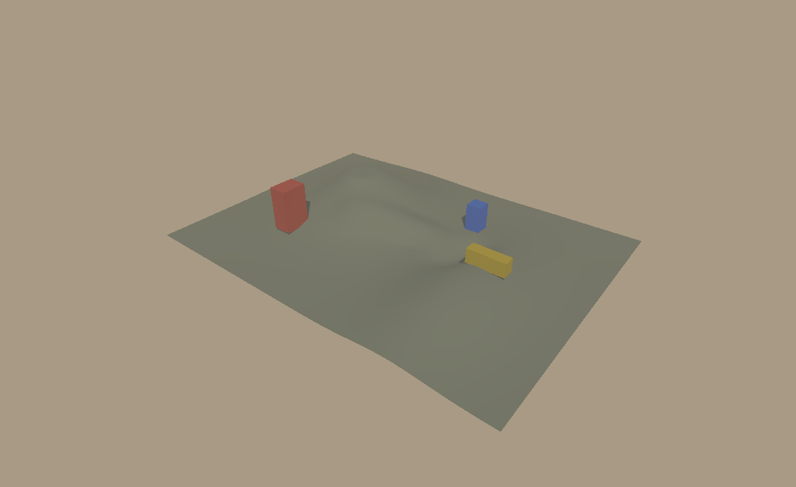

# LAB-02A · 雕刻与持续动态更新

2026-10-19，HEAD `4c8b380` 及当前未提交工作区。结论：**65×65 独立雕刻实验通过**，提供 Raise/Lower/Smooth/Flatten、区域差异历史、持续 SPQR 网格更新和独立操作窗口。未集成主编辑器。下一阶段是 LAB-02B 三层材质。

## 运行与操作

仓库根目录运行，依赖和构建环境见 [README](README.md)。输出须为新目录或空目录。

```powershell
# 自动事件回放、GPU校验、计时及单独录像回放
F:/gymenv/python.exe -B experiments/world-surroundings/run_sculpt.py --output captures/world-surroundings/sculpt-check

# 直接进入独立鼠标操作窗口；关闭窗口结束
F:/gymenv/python.exe -B experiments/world-surroundings/run_sculpt.py --output captures/world-surroundings/sculpt-live --interactive
```

| 操作 | 效果 |
| --- | --- |
| `1` / `2` / `3` / `4` | 抬高 / 降低 / 平滑 / 平整；切换模式取消当前笔画 |
| 左键按住并拖动，松开 | 预览，随后提交一条历史 |
| 滚轮 | 调整下一笔半径；当前笔画半径固定 |
| `Esc` | 取消当前笔画；空闲时不修改数据 |
| `Z` / `Y` | 空闲时撤销 / 重做 |

标题显示模式和半径。窗口使用固定斜俯相机，没有正式工具面板、画笔范围圈、模型选择或相机导航。强度通过实验代码/会话参数设置，窗口按模式使用固定强度。Flatten 默认采样第一下有效命中的三角面高度；显式数值目标由 `SculptSession.begin_stroke(..., target_height=...)` 提供。

## 数据与更新契约

- `sculpt.py` 管理不可变 Heightfield 和修订号。抬高/降低按米/秒、Smooth/Flatten 按指数收敛率累计；圆形 smoothstep 衰减。平滑目标来自笔画开始时的3×3邻域均值，边缘重复采样，一笔内目标稳定。
- 鼠标命中当前派生三角网格；移动按不超过笔画半径的20%分段，均分该帧的时间。固定位置的时间拆分经过数值回归；不同采样的任意移动轨迹不保证逐位相同。
- 一笔保存受影响矩形的 float64 前后差异，默认64MiB历史预算；超预算拒绝并回滚该笔，保留既有 Undo/Redo。取消和无变化不生成历史。
- CPU 每次有效 dab 仍派生完整 Heightfield/法线。法线改用 float64 `bincount` 归约；随机2×2、矩形、65×65、257×257及不同高程尺度的最终 float32 法线与原 `add.at` 实现逐字节对照通过。该优化不等于局部CPU更新。
- `run_sculpt.py` 生成全部CPU分块载荷，再比较实际变化，仅将变化块上传GPU；这也包含高度变化引起的相邻法线变化。每块32×32单元。本次4块共有4356个打包顶点，顶点载荷209088字节；三角形仍为8192个。
- `terrain_bridge.cpp` 链接现有 SPQR 核心，通过已有 VBO 的 `BufferSubData` 更新固定拓扑的Z/法线，刷新CPU bounds并使阴影缓存失效。连续笔画期间不重新导出Bundle，不新建Renderer或shader。
- 唯一共享核心改动是 `renderer.hpp` 中 `SPQR_TERRAIN_LAB` 宏隔离的friend钩子；生产CMake、正式DLL ABI、Bundle格式及编辑器保持原接口。具体设计见 [DYNAMIC-DESIGN.md](DYNAMIC-DESIGN.md)。

## 实测与图像

最终验收：[完整报告](review/lab02a-20261019-verified/report.json)、[输入事件记录](review/lab02a-20261019-verified/input-replay.json)、[连续雕刻GIF](review/lab02a-20261019-verified/sculpt-replay.gif)。此处链接为review中的审阅快照；完整原始产物仍位于已忽略的captures。

| 初始 | 抬高后 | 四笔完成、平整后 |
| --- | --- | --- |
|  |  |  |

真实GL结果已检查。绿色是沿用基线的单一材质，不代表草地材质绘制。三个标记模型在雕刻时保持最初世界变换，与规划中“地形编辑不自动移动模型”的约定一致。

实际设备为 **Intel UHD Graphics 620，OpenGL 3.3.0，驱动27.20.100.8682**。与LAB-00/01独立viewer使用的MX130不同，不能直接横比。Python3.8.20、NumPy1.24.3、Pygame2.6.1、Pillow9.5.0；MinGW g++15.2 Release。1081×662、1x AA，稳定远阴影1024、近阴影4096，同一固定斜俯相机。实验DLL SHA256为 `b9dc66a3dba6422bc8d8622e9a74c4213e9c3812bbc3cba24314c6e623e10093`，源码摘要在报告中。

事件经真实Pygame队列进入与窗口相同的事件处理/笔刷路径，以1/30秒步长回放130帧：四种笔刷各一笔，再做预览取消和Undo/Redo。GPU绘制采用同一持久Renderer。计时含事件处理、当前表面拾取、CPU笔刷/网格、上传、绘制及`glFinish`、swap；检查点导出/读回不在样本中。

| 毫秒 | P50 | P95 | P99 |
| --- | ---: | ---: | ---: |
| 完整实验帧 | 22.63 | 28.04 | 31.04 |
| CPU更新与上传（事件处理后） | 9.69 | 14.13 | 17.10 |
| 原生绘制与glFinish | 12.89 | 14.64 | 15.38 |
| swap | 0.05 | 0.09 | 0.25 |

最大完整帧36.33ms，最大CPU更新与上传20.86ms；P95在33.33ms目标内，仍有长尾。首轮优化前完整帧P95约38.03ms，优化后两轮约29.76/28.04ms；首轮报告为 [lab02a-20261019](review/lab02a-20261019/report.json)，它与最终版本还存在输入健壮性/清理方面的少量差异，不作为严格隔离变量的微基准。

测量期间126次批量上传、17302032字节，单帧变化块数覆盖0～4；shader编译数始终为3，网格数7不变。四笔历史载荷共21840字节，少于四份完整高度前后数组的270400字节。这里报告载荷和传输量，未测进程峰值内存或驱动实际显存占用。

录像使用第二轮相同输入，在同一Renderer恢复初始载荷后重放；每5帧读取一次真实颜色，共26帧、648×397 GIF，26帧均不同。最终高度SHA256与测量回放相同。GIF以固定模拟时间播放（编码后的每帧160ms），不代表实测墙钟帧率，读回和编码未混入上表。事件JSON供检查；当前命令内置同一回放生成器，尚无从任意JSON重放的CLI。

## 验证与边界

- 8个检查点均逐字节核对GPU顶点与CPU载荷、分块位置/法线接缝，并各以41个表面查询对照实际三角面射线；最大高度误差 `3.56e-15` 世界单位。
- 初始、四种笔刷、Undo共6个状态，动态结果的RGBA与远阴影深度和相同地形全新构建Renderer逐字节相同。取消与Redo另与平整完成状态逐字节相同。近阴影启用，颜色比较包含其视觉效果，未单独读回近阴影深度。
- 非法后续网格ID、重复ID、错误顶点数、修改XY、NaN、零法线6种整批拒绝；读回和上传计数不变。错误线程/context拒绝，原context恢复后可正常关闭。真实GL上传失败进入致命状态，要求重建，不承诺GPU回滚。
- [可见窗口启动记录](review/lab02a-20261019-window/report.json)：`--interactive --live-frames 30`，30帧正常启动、绘制、关闭；不标记为自动回放验收。输入功能由上述队列回放验证，未声称完成人工鼠标体验验收。
- 81项CPU测试通过：World Surroundings 38、Placement 10、Native Renderer 12、Native Preparation 6、Scene Snapshot 15。使用以下discover命令，替换末尾pattern可运行其余四组。

```powershell
F:/gymenv/python.exe -B -m unittest discover -s tests -p 'test_world_surroundings_*.py'
```

常规生产目标 `spqr-native`、`spqr_photo` 在隔离build-lab00重新构建通过，无实验宏。[现有native_preparation_gpu_smoke结果](review/lab02a-production-regression/report.json)通过：分阶段准备/取消、就绪前拒绝、共享纹理所有权、shader缓存及uniform恢复。为保护用户现有二进制，仅在内存中将该测试的`configure_library`参数指向隔离构建DLL，未修改测试源码或替换`native/spqr_photo.dll`。

257×257只做过CPU数值/静态实验，未验收动态性能。完整Editor UI开销、统一模型/地形命令历史、Scene持久化、Shot同步、Python fallback和笔刷范围UI仍留待集成。当前结果足以进入LAB-02B，不能据此宣布完整编辑器达到30 FPS。
