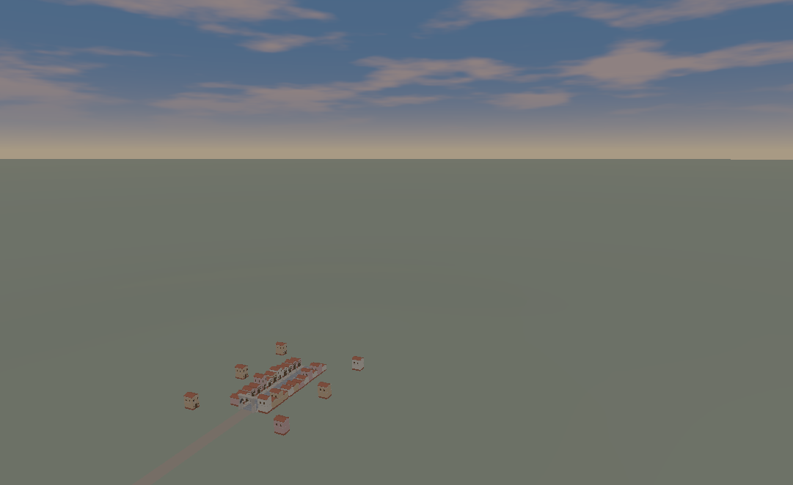
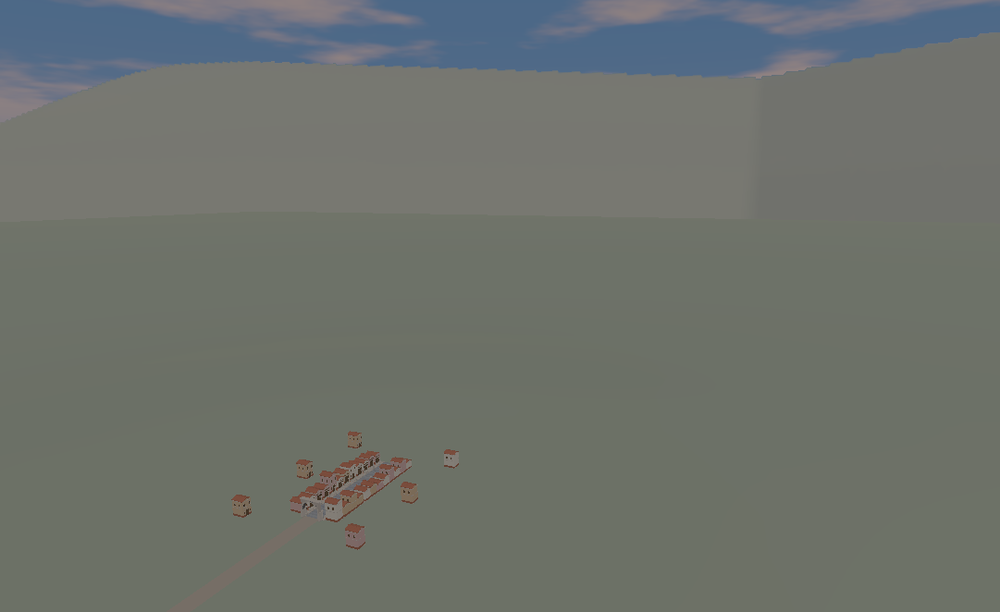
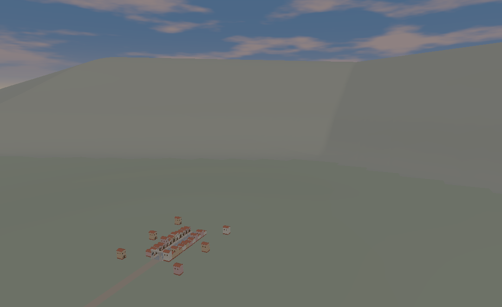

# SUR-00 审阅入口

这些是同一SPQR核心实际渲染的固定罗马郊外。PNG与本地captures逐字节一致，没有后期增强；GIF来自单独路线回放，缩小并按固定模拟时间播放，不代表实测帧率。完整解释和复现见 [SUR-00.md](../../SUR-00.md)。

本轮选择C三维地理作为后续主线。当前仍是技术原型：近阴影拟合、地平线、地表细节和可信郊外均有未完成项，不能标记完整世界、摄影画质或30 FPS通过。

| 白天无Haze，高空 | A：共同地面＋天空 | B：固定烘焙背景 | C：三维山脊 |
| --- | --- | --- | --- |
| 同一相机 |  |  |  |

- [C街道](day-clear/C/views/street.png)、[出口回望](day-clear/C/views/exit_return.png)、[向南望](day-clear/C/views/outward_south.png)、[垂直俯视](day-clear/C/views/nadir.png)
- [C宽角75°](day-clear/C/views/aerial_75.png)、[85mm垂直拟合参考](day-clear/C/views/telephoto.png)
- [升降A](day-haze/A/motion/ascent.gif)、[升降B](day-haze/B/motion/ascent.gif)、[升降C](day-haze/C/motion/ascent.gif)
- [横移B](day-haze/B/motion/lateral.gif)、[横移C](day-haze/C/motion/lateral.gif)、[C高空边缘巡检](day-haze/C/motion/boundary.gif)
- [夕阳C](sunset-haze/C/views/aerial.png)、[较强Haze C](day-haze-strong/C/views/aerial.png)
- [完整原始测量JSON](measurements/report.json)、[汇总与核验](summary.json)、[文件来源及摘要](manifest.json)

固定机位的相机/near/far、全部原始逐帧数据、资源统计、各光照批次和镜头扫参元数据保存在原始报告中。审阅包保留全部白天无Haze固定机位、若干其他光照机位、C全部六条路线GIF及A/B的升降/横移对照；未打包的完整Bundle、PNG序列、远阴影深度和构建输出可通过复现命令重新生成。没有用精选图代替SUR-03手动自由摄影验收。
